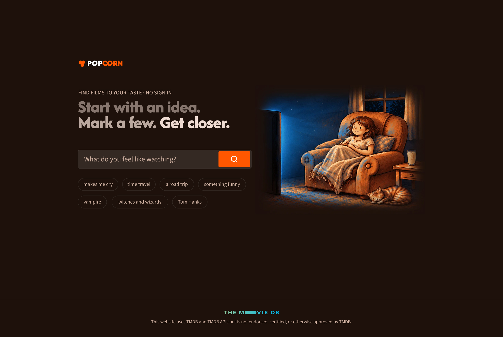

# Popcorn

A film recommender that learns from your taps. Type an idea, mark a few films, press Refresh, and the list moves towards your taste. No sign-in.

**Live**: [popcorn-jing.vercel.app](https://popcorn-jing.vercel.app/)

**Design**: [Figma](https://www.figma.com/design/moBbyis5f87CvI4eKIdd2e/movie-recommender?node-id=273-2270&t=ubWrDD13y3Ch690Y-1)



Designed and built by Jing, from the data pipeline to the interface.

---

## How it works

1. **Start with an idea.** Type anything, like "magic" or "makes me cry", or tap an example.
2. **Mark a few films.** Like, dislike or save any film in the list. Tap a poster to see its trailer, runtime and age rating.
3. **Press Refresh.** The whole catalogue is ranked again, towards what you marked. Repeat as often as you like.

Saved films stay in their own list. Sending that list to your email is planned.

Most film sites need an account and a viewing history before they can recommend anything. Popcorn needs one idea and a few taps. **The tap loop is the product.** Search is only how it starts.

---

## Design

I tested the first version with four people, and what they ran into led to a full redesign:

- **Poster, title and year were not enough to decide.** People saved films they had not really chosen. So I added a detail view with the trailer, runtime and age rating.
- **Like and Save were hard to tell apart**, and Save only appeared on hover. So I made Save clearer and always visible.

The designs are in [Figma](https://www.figma.com/design/moBbyis5f87CvI4eKIdd2e/movie-recommender?node-id=273-2270&t=ubWrDD13y3Ch690Y-1).

---

## Architecture

**Everything runs in the browser. There is no server.**

- **The catalogue** is 4,999 films with precomputed vectors, shipped as static files. The vectors are reduced from 384 to 192 dimensions with PCA and packed as int8: 6.7MB or 3.6MB over the network.
- **The query** is embedded in the browser by an 8-bit copy of the same model: 23MB, or 15.6MB over the network. It starts downloading when the page opens, so it is usually ready before someone finishes typing. After the first visit, the browser keeps it.
- **Each re-rank** is a dot product over the whole catalogue, and takes about 15ms.

The catalogue is capped at 5,000 films because everything has to reach the browser before it can be used.

---

## How search works

Each film has seven text fields: genres, tagline, overview, keywords, cast, director, reviews. **Each field is embedded separately**. For every query, the app decides how much each field counts, by how clearly it found a match. "Tom Hanks" needs the cast field. "vampire" barely needs it at all.

**Embedding search is good at meaning and weak at facts.** A name the model never learned, like "Carey Mulligan", finds none of her films. The planned fix is **hybrid search**: an exact match on cast, director and title first, with the embedding ranking the rest.

The method is in [`docs/02-method.md`](docs/02-method.md), and the results in [`docs/03-findings.md`](docs/03-findings.md).

---

## Results

17 test queries, scored by hand on their top 10 films, against rules written before any results were seen.

| Query type                                         | Score             |
| -------------------------------------------------- | ----------------- |
| names, like "a Christopher Nolan movie"            | 19/20             |
| mood, like "really scary"                          | 37/40             |
| topic, like "vampire"                              | 44/50             |
| two ideas at once, like "fall in love with a city" | 28/60             |
| **total**                                          | **128/170 (75%)** |

These were scored on the full-size vectors. The live app runs on compressed vectors and an 8-bit model in the browser, and 155 of the 170 films scored here still appear in its top 10 lists.

---

## Run it locally

```
cd app
npm install
npm run dev
```

The first run downloads the 23MB model into `app/public/models/`. The film data is already in `app/public/`, so the app runs without the data pipeline.

To rebuild the data, put a TMDB API read token in `.env` as `TMDB_TOKEN`. Then run the scripts in `experiments/` with `uv`, in this order: `fetch`, `embed`, `dedupe`, `shrink`, `export`. For example: `uv run experiments/fetch.py`.

---

## Stack

- Python and `uv` for the offline pipeline
- TMDB API for metadata, posters and trailers
- `sentence-transformers`, model `all-MiniLM-L6-v2`: films embedded at 384 dims, then reduced to 192 with PCA and packed as int8
- React and Vite for the app
- `transformers.js` for the query, running an 8-bit ONNX copy of the same model in the browser
- Vercel for hosting. Static files only

---

## Repo

```
app/          the React app, and the files it ships in public/
experiments/  the data pipeline (fetch, embed, dedupe, shrink, export) and the experiments
docs/         the product, the method, the findings
notes/        where the project stands
data/         raw JSON, vectors and model files (not committed)
assets/       images for the docs
```

---

## Next

1. **Hybrid search**: exact matching for names and titles.
2. **A user test with 5 to 10 people**, to see whether the tap loop really moves the list towards what people want.
3. **An LLM filter** for queries that ask for two things at once.

---

## Data


Movie data from [TMDB](https://www.themoviedb.org/). This product uses the TMDB
API but is not endorsed or certified by TMDB.
